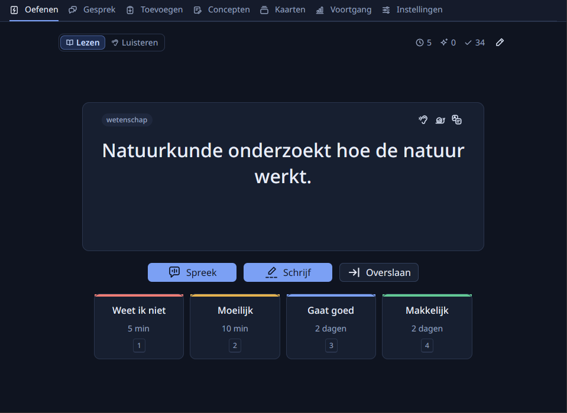
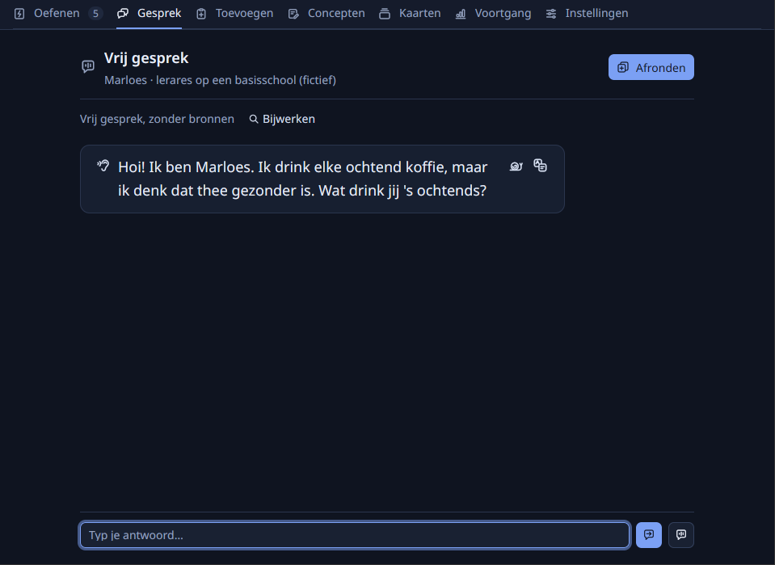
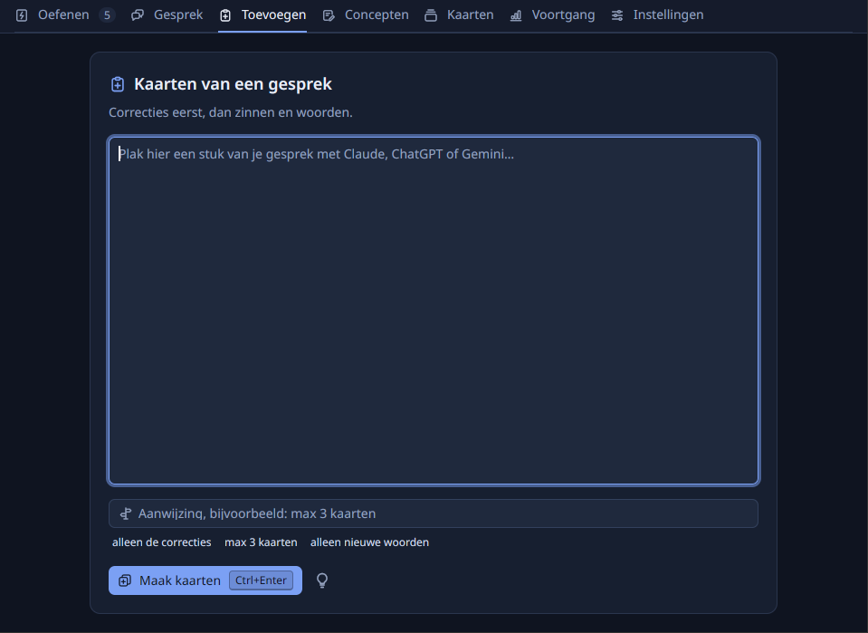
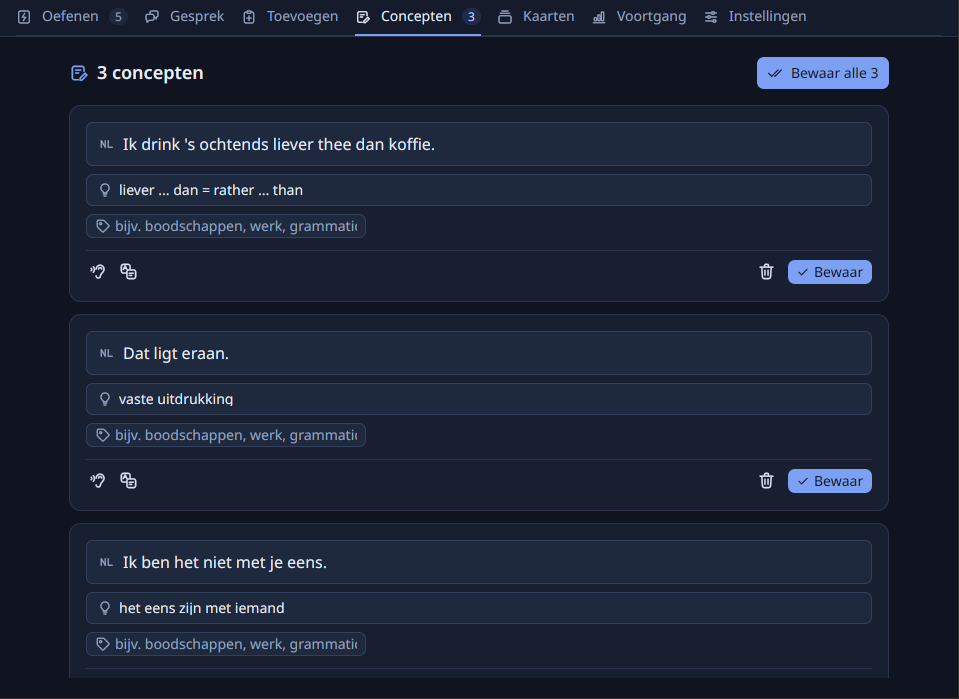
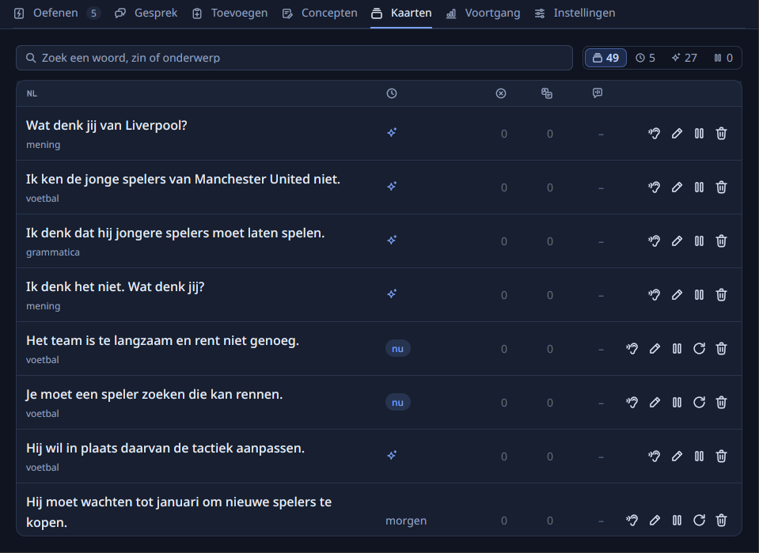
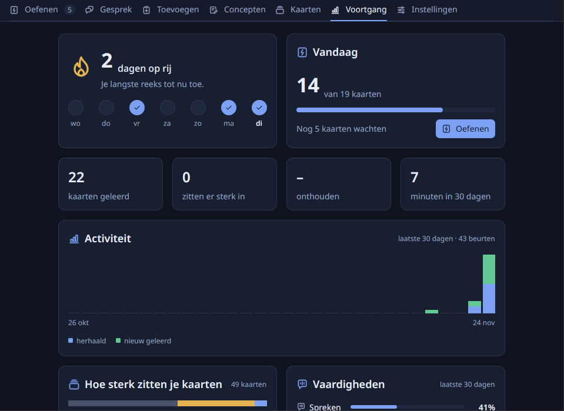
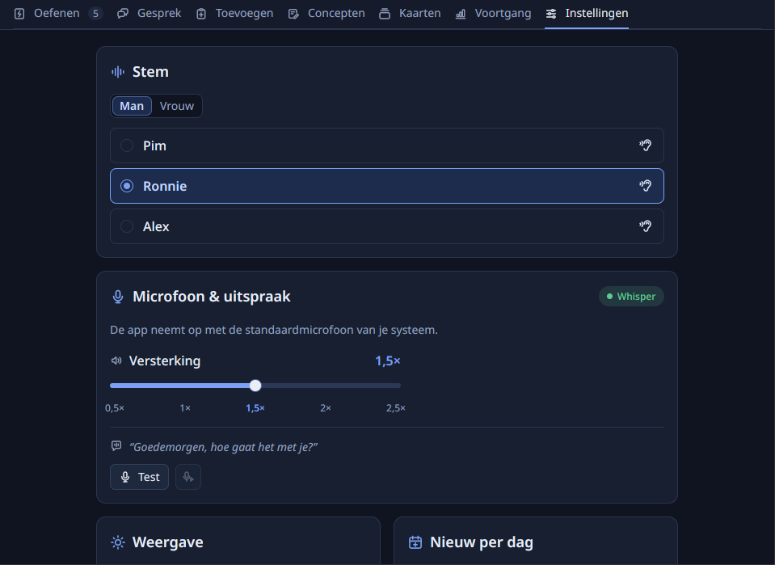

# Flitskaart

A cheap way to learn a language - inspired by the flash cards I used to learn languages in the past.
It has two modes - you give it a topic & it has a conversation with you. It turns those conversations into flash cards.
You can also spam it a whole load of text - it will turn those into flash cards.

It tests you by either listening to you speak the card, or type the card.

Its main goal is to be cheap - so it listens to you using whisper & speaks using piper.
LLMs are provided only with text to interpret & reply to. (it will use any locally logged in CLI)

## The tabs

### Oefenen



Practise the cards that are due - speak the card or type it, then score how well it came back.\
The better you know it, the longer until it comes back.

### Gesprek



Pick a topic (or none) & chat with a made-up partner, by voice or by typing.\
Every line you send comes back corrected - press Afronden & the useful bits become flash cards.

### Toevoegen



Spam it a chunk of text - say a conversation you had with Claude, ChatGPT or Gemini.\
Your corrected mistakes become cards first, then the new phrases & words.

### Concepten



New cards wait here until you have checked them.\
Fix the Dutch, the note or the English, listen to it, then keep it or bin it.

### Kaarten



Every card you kept, searchable.\
Edit, pause, reset or delete a card & see how often you missed it.

### Voortgang



How it is going - your streak, what is left today & how well the cards stick.\
Also how your speaking, writing & listening moved over the last 30 days.

### Instellingen



Pick a voice, test the microphone & choose how many new cards a day.\
Also which logged-in LLM tool & model to use, and how many tokens it has used.

## Running it

```sh
nix develop                  # or `direnv allow` once
scripts/fetch-models.sh      # Piper voices + Whisper, ~830 MB, checksummed
cargo run --release -p dutch-flashcards
```

Card drafting and conversations run the chosen tool with your own login (no API
key): `claude -p`, `codex exec`, `agy --print` or `pi -p`, each asked for JSON
in a fixed shape. Claude Code and Antigravity hold the answer to the shape
themselves; Codex gets a strict version of it; Pi gets it in its instructions. Each paste is one request and takes 5–15 seconds; each conversation
turn takes about 3 seconds.

